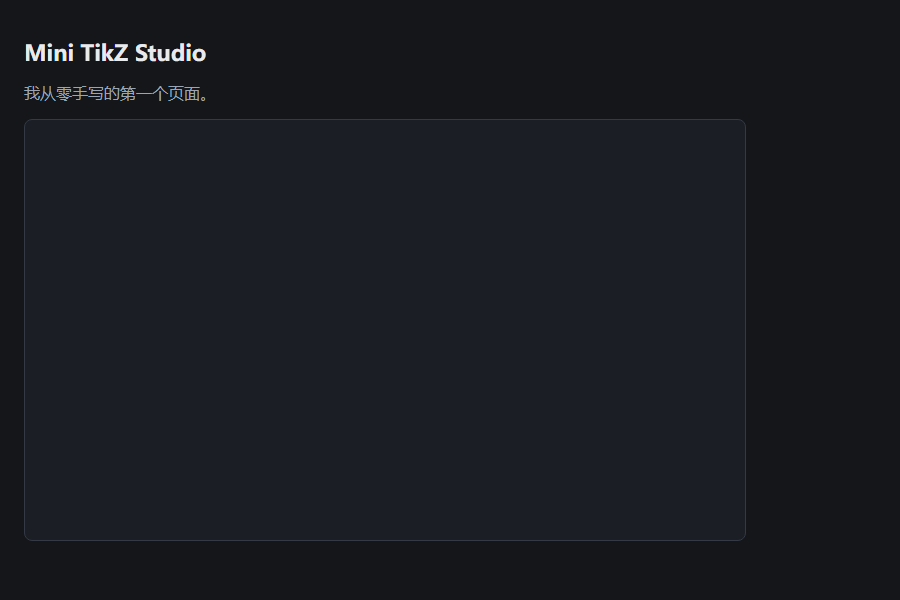

# 第 1 课：网页是什么，写出第一个页面

## 本课目标

- 分清文件夹、文件、扩展名
- 知道浏览器怎么打开 HTML
- 写出一个页面：标题、说明、画布
- 会用 F12 改文字、看 Console
- 不要求理解 CSS / JS 的每个细节

## 先理解三个词

1. **文件**：硬盘上的一块数据，有名字，通常有扩展名。比如 index.html。
2. **文件夹**：装文件的盒子。我们的盒子是 D:\FDU_AIagentDevelop\handmade-tikz。
3. **HTML**：一种文本格式，用“标签”描述网页里有什么。浏览器读到它，就画出页面。

网页的本质：**一个文本文件 + 一个会解释它的浏览器**。

## 你要用到的工具

- VS Code（写代码）
- Edge（看结果）
- 我们的学习文件夹：D:\FDU_AIagentDevelop\handmade-tikz

## 步骤

### 1. 在 VS Code 里打开学习文件夹

1. 按 Win 键，输入 Visual Studio Code，回车。
2. 菜单 File → Open Folder...
3. 在地址栏粘贴：D:\FDU_AIagentDevelop\handmade-tikz
4. 点“选择文件夹”。
5. 左侧 Explorer 里应该能看到 PLAN.md、progress.md、lessons。

如果 VS Code 问“是否信任此文件夹的作者”，选“是，我信任”。

### 2. 新建 index.html

1. Ctrl+N 新建文件。
2. Ctrl+S 保存。
3. 文件名输入：index.html
4. 位置选 handmade-tikz 文件夹。
5. 保存。

注意：如果资源管理器显示的是 index.html.txt，说明你被 Windows 隐藏扩展名骗了。看“常见错误”第 1 条。

### 3. 输入下面的代码

先自己照着敲。不要整段复制粘贴。

~~~html
<!doctype html>
<html lang="zh-CN">
<head>
  <meta charset="UTF-8">
  <meta name="viewport" content="width=device-width, initial-scale=1.0">
  <title>Mini TikZ Studio</title>
  
</head>
<body>
  <h1>Mini TikZ Studio</h1>
  
我从零手写的第一个页面。

  <canvas id="stage" width="720" height="420"></canvas>

  
</body>
</html>
~~~

### 4. 保存并在浏览器里打开

1. Ctrl+S 保存。
2. 在 VS Code 左侧的文件列表里，右键 index.html。
3. 选 Reveal in File Explorer（在资源管理器中显示）。
4. 在资源管理器里双击 index.html，或右键 → 打开方式 → Microsoft Edge。
5. 你应该看到：深色页面、标题、一行灰字、一个带边框的深色矩形。

### 5. 打开开发者工具

1. 在浏览器里按 F12（或 Ctrl+Shift+I）。
2. 选 Elements 面板：这里能看到浏览器实际解析出的 HTML。
3. 双击 <code>&lt;h1&gt;</code> 里的文字，改成“你好”，回车。页面会立刻变。
4. 刷新页面。刚才的修改没了，因为改的是浏览器里的临时副本，不是硬盘上的文件。
5. 选 Console 面板：应该能看到“页面加载完成”。

### 6. 在 Console 里做两个小实验

在 Console 里输入下面两行，每行回车：

~~~js
1 + 2
document.querySelector("h1").textContent = "Hello"
~~~

第一行会显示 3。第二行会把标题改成 Hello。

这一步只是让你知道：JavaScript 可以修改页面。下节课再解释原理。

## 逐行解释

### 文档声明

- <code>&lt;!doctype html&gt;</code>：告诉浏览器“这是现代 HTML”。不写的话，浏览器可能进入奇怪的兼容模式。
- <code>&lt;html lang="zh-CN"&gt;</code>：整个文档的根标签。lang 告诉浏览器和屏幕阅读器：内容是中文。

### head：给浏览器看的信息

- <code>&lt;head&gt;...&lt;/head&gt;</code> 里的内容不会直接显示在页面上。
- <code>&lt;meta charset="UTF-8"&gt;</code>：字符编码。没有它，中文可能变成乱码。
- <code>&lt;meta name="viewport" ...&gt;</code>：让手机浏览器按屏幕宽度显示，而不是假装自己是 980px 宽的桌面。
- <code>&lt;title&gt;</code>：浏览器标签页上的文字。
- <code>&lt;style&gt;</code>：CSS，负责“长什么样”。这里只是让页面变成深色、给画布加边框。

### body：给人看的内容

- <code>&lt;h1&gt;</code>：一级标题。数字越小，级别越高。
- <code>&lt;p&gt;</code>：段落。
- <code>&lt;canvas&gt;</code>：一块画布，默认是透明的。width 和 height 是它的实际像素尺寸；id="stage" 是给它起名字，以后 JavaScript 要用这个名字找到它。
- <code>&lt;script&gt;</code>：JavaScript。页面加载到这里时执行 console.log，往 Console 打印一句话。
- 每个开始标签都要有对应的结束标签，例如 <code>&lt;h1&gt;</code> 和 <code>&lt;/h1&gt;</code>。

### 关于 CSS 和 JS

现在不需要记住所有属性。你只要知道：

- CSS 决定“长什么样”；
- JavaScript 决定“能做什么”；
- HTML 决定“有什么”。

## 自检

- [ ] 页面能打开
- [ ] 中文没有乱码
- [ ] 能看到深色画布
- [ ] Console 里有“页面加载完成”
- [ ] 能说出 head 和 body 的区别
- [ ] 能说出 id 的作用

## 作业

1. 把 h1 改成你自己的标题，p 改成一句你想说的话。
2. 在 canvas 前面加一个 <code>&lt;h2&gt;画布&lt;/h2&gt;</code>。
3. 在 canvas 后面加一个按钮：<code>&lt;button&gt;画一条线&lt;/button&gt;</code>。现在点了没反应，正常，L03 才学。
4. 把 canvas 的 width 改成 900，height 改成 500，刷新看变化。
5. 故意删掉 <code>&lt;/h1&gt;</code>，刷新，观察页面和 Console；再按 Ctrl+Z 恢复。把现象记下来。
6. 在 progress.md 的“学习记录”里写 3 行。

## 常见错误

1. **文件名变成 index.html.txt**
   Windows 默认隐藏已知扩展名。在资源管理器顶部点“查看”，勾选“文件扩展名”；或者在 VS Code 里看标签页，确认是 index.html。重新另存为，选“所有文件”，文件名写 index.html。

2. **中文乱码**
   确认 head 里有 <code>&lt;meta charset="UTF-8"&gt;</code>；确认 VS Code 右下角显示 UTF-8。

3. **页面一片空白**
   按 F12 看 Console 第一条红色错误；再检查标签有没有闭合。最常见的是漏了 <code>&lt;/body&gt;</code> 或 <code>&lt;/html&gt;</code>。

4. **双击打开的是编辑器**
   右键 index.html → 打开方式 → Microsoft Edge。

5. **改了代码，页面没变**
   Ctrl+S 保存，然后在浏览器里 Ctrl+F5 强制刷新。

6. **画布看不见**
   检查 width / height 是不是写成了 0；检查 CSS 里有没有 display: none。

7. **中文标点 / 全角符号**
   代码里的引号、尖括号、分号必须是英文半角。比如 “text” 和 "text" 看起来像，但前者会让浏览器报错。输入法切到英文再写代码。

8. **结束标签重复**
   VS Code 通常会自动补 </h1>。如果你又手打了一遍，就会变成 </h1></h1>。看一眼再继续。

## 下一课

L02：CSS Grid 三栏布局。把“标题 + 画布”变成“左源码 / 右画布 / 底部状态栏”的编辑器骨架。
