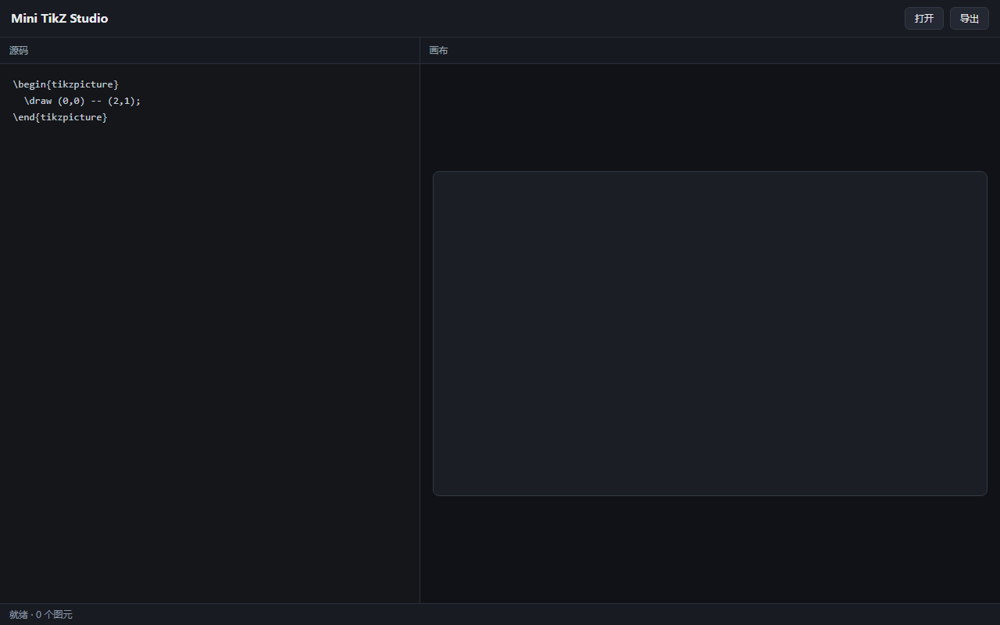

# 第 2b 课：CSS Grid——把页面变成编辑器骨架

> 如果“grid”让你发懵，先做 [02a 三个盒子](02a-grid-first.md)，再回来。

## 本课目标

- 把单列页面改成编辑器骨架：顶栏 / 左源码 / 右画布 / 底部状态栏
- 学会 class 选择器
- 学会 CSS Grid 的行、列和 `1fr`
- 学会用 Flex 让每个面板“头固定、身体滚动”
- 理解 `100vh`、`min-height: 0`、`overflow: auto`
- 选做：窗口变窄时上下堆叠

## 本课成品

## 开始前：备份 L01

1. 打开 `index.html`。
2. 菜单 File → Save As，另存为 `index-l01.html`。
3. 确认 Explorer 里有两个文件：`index.html`、`index-l01.html`。
4. 后面只改 `index.html`。

为什么要备份：这一课会重写大部分 CSS。留着 L01，出问题还能对照。

## 1. 先搭 HTML 盒子

把 `<body>` 里的内容换成下面这样。先不要管 CSS，刷新后你会看到内容从上到下堆在一起，这是正常的。

~~~html
<body>
  

    <header class="topbar">
      <h1>Mini TikZ Studio</h1>
      

      <button type="button">打开</button>
      <button type="button">导出</button>
    </header>

    <main class="workbench">
      <section class="pane pane-editor">
        
源码

        

          <pre class="code">\begin{tikzpicture}
  \draw (0,0) -- (2,1);
\end{tikzpicture}</pre>
        

      </section>

      <section class="pane pane-canvas">
        
画布

        

          <canvas id="stage" width="720" height="420"></canvas>
        

      </section>
    </main>

    <footer class="statusbar">就绪 · 0 个图元</footer>
  

  
</body>
~~~

几个新东西：

- `<header>`、`<main>`、`<footer>`、`<section>` 是“语义标签”：它们本身不带样式，只是告诉读代码的人“这块是什么”。
- `class="app"` 是给元素起一个“样式名”。CSS 里用 `.app` 选中它。
- 一个元素可以有多个 class，用空格分开，例如 `class="pane pane-editor"`。
- `<pre>` 会保留空格和换行，适合放代码文本。里面的反斜杠是普通字符，不是转义。
- 注意：`<pre>` 里的缩进会原样显示。不要为了对齐 HTML 而在代码前面加很多空格。

## 2. 让 app 占满窗口

现在开始写 CSS。先把原来的 CSS 全部替换成下面这段：

~~~css
* {
  box-sizing: border-box;
}

body {
  margin: 0;
  overflow: hidden;
  background: #14161a;
  color: #e8eaed;
  font-family: system-ui, sans-serif;
}

.app {
  height: 100vh;
  display: grid;
  grid-template-rows: 48px 1fr 28px;
}
~~~

逐条解释：

- `* { box-sizing: border-box; }`：让 `width` / `height` 包含 padding 和 border。后面有很多 1px 边框，不加这句很容易整体宽出 1px、出现滚动条。
- `body { margin: 0; overflow: hidden; }`：去掉默认外边距，禁止整个页面滚动；以后只让面板内部滚动。
- `.app` 是 class 选择器：选中 `class="app"` 的那个 `
`。
- `height: 100vh`：`vh` 是 viewport height，窗口高度的 1%。`100vh` 就是整个窗口高。
- `display: grid`：把 `.app` 变成网格容器。
- `grid-template-rows: 48px 1fr 28px`：三行。第一行 48px（顶栏），第三行 28px（状态栏），中间 `1fr` 吃掉剩下的全部高度。

`1fr` 可以理解成“一份剩余空间”。只有一个 `1fr` 时，它就是“剩下的全部”。

此时刷新：顶栏、内容区、状态栏已经分成上中下三块，但内容区里的两个 `section` 还是上下堆着。

## 3. 左右分栏

继续加：

~~~css
.workbench {
  display: grid;
  grid-template-columns: minmax(280px, 42%) 1fr;
  min-height: 0;
}

.pane {
  display: flex;
  flex-direction: column;
  min-width: 0;
  min-height: 0;
}

.pane-editor {
  border-right: 1px solid #2a2f3a;
}
~~~

解释：

- `.workbench` 是中间那一行，现在把它也变成网格，分成左右两列。
- `grid-template-columns: minmax(280px, 42%) 1fr`：
  - 左列“理想宽度是 42%，但不小于 280px”；
  - 右列用 `1fr` 吃掉剩下的宽度。
- `.pane` 用 Flex 竖排：因为每个面板里面是“标题头 + 内容身体”上下两块。
- `min-width: 0` 和 `min-height: 0` 是 Grid / Flex 的常见坑：子元素默认不愿意缩到内容以下，加了 0 才允许它缩小，后面的 `overflow: auto` 才会生效。
- `border-right` 只给左面板加右边框，形成分界线。

此时刷新：左右两栏已经分开。但“源码”“画布”的标题头和内容还没有排版。

## 4. 面板内部：头固定，身体滚动

继续加：

~~~css
.pane-head {
  flex: none;
  height: 34px;
  display: flex;
  align-items: center;
  padding: 0 12px;
  font-size: 12px;
  color: #9aa4b2;
  background: #161920;
  border-bottom: 1px solid #2a2f3a;
}

.pane-body {
  flex: 1;
  min-height: 0;
  overflow: auto;
}
~~~

解释：

- `.pane-head` 固定 34px 高，用 Flex 让文字垂直居中。
- `.pane-body` 的 `flex: 1` 表示“把剩下的高度都给我”。
- `overflow: auto` 表示“内容超出时，自己出现滚动条”。
- 这里再次出现 `min-height: 0`：没有它，`.pane-body` 会拒绝缩小，滚动条不会出现，整个页面反而被撑高。

现在，每个面板都是“头固定、身体可滚动”的结构。

## 5. 外观：顶栏、按钮、状态栏、画布

最后补外观：

~~~css
.topbar {
  display: flex;
  align-items: center;
  gap: 8px;
  padding: 0 14px;
  background: #181b21;
  border-bottom: 1px solid #2a2f3a;
}

.topbar h1 {
  margin: 0;
  font-size: 15px;
}

.spacer {
  flex: 1;
}

button {
  font: inherit;
  font-size: 12px;
  color: #e8eaed;
  background: #232833;
  border: 1px solid #333a45;
  border-radius: 6px;
  padding: 6px 12px;
  cursor: pointer;
}

button:hover {
  background: #2b3140;
}

.code {
  margin: 0;
  padding: 16px;
  font: 13px/1.6 Consolas, "Courier New", monospace;
  color: #c8d0dc;
  white-space: pre;
}

.canvas-body {
  display: grid;
  place-items: center;
  padding: 16px;
  background: #101217;
}

canvas {
  display: block;
  max-width: 100%;
  background: #1b1e24;
  border: 1px solid #333a45;
  border-radius: 8px;
}

.statusbar {
  display: flex;
  align-items: center;
  padding: 0 12px;
  font-size: 12px;
  color: #8b95a5;
  background: #181b21;
  border-top: 1px solid #2a2f3a;
}
~~~

解释：

- `.topbar` 用 Flex 横排；`align-items: center` 垂直居中；`gap: 8px` 是子元素之间的间距。
- `.spacer { flex: 1; }` 是一个空的 `div`，它把后面的按钮推到最右边。
- `button` 选择器会选中页面上所有 `<button>`。`font: inherit` 让按钮继承页面字体，不然浏览器会给按钮一套自己的字体。
- `.code` 给 `<pre>` 设置等宽字体、内边距和颜色。
- `.canvas-body` 用 Grid 的 `place-items: center` 把画布在面板里居中。
- `canvas { max-width: 100%; }` 防止画布比面板宽。注意：这是把“显示尺寸”缩小，画布内部的 720×420 坐标不变；L04 会处理坐标换算。
- `.statusbar` 只做一行字的排版。

## 6. 选做：窄窗口上下堆叠

如果窗口宽度小于 760px，左右两栏会挤。可以加一段媒体查询，让它变成上下两块：

~~~css
@media (max-width: 760px) {
  .workbench {
    grid-template-columns: 1fr;
    grid-template-rows: 1fr 1fr;
  }

  .pane-editor {
    border-right: 0;
    border-bottom: 1px solid #2a2f3a;
  }
}
~~~

- `@media (max-width: 760px)` 的意思是“窗口宽度不超过 760px 时，才用下面这些规则”。
- 左右两列改成一行两行：`grid-template-rows: 1fr 1fr` 让上下各占一半高度。
- 左边框改成下边框。

媒体查询要放在 CSS 的最后，否则可能被前面的规则覆盖。

## 7. 完整代码

把上面的 HTML 和 CSS 合起来，就是下面这样。可以先自己拼，再对照。

~~~html
<!doctype html>
<html lang="zh-CN">
<head>
  <meta charset="UTF-8">
  <meta name="viewport" content="width=device-width, initial-scale=1.0">
  <title>Mini TikZ Studio — L02</title>
  
</head>
<body>
  

    <header class="topbar">
      <h1>Mini TikZ Studio</h1>
      

      <button type="button">打开</button>
      <button type="button">导出</button>
    </header>

    <main class="workbench">
      <section class="pane pane-editor">
        
源码

        

          <pre class="code">\begin{tikzpicture}
  \draw (0,0) -- (2,1);
\end{tikzpicture}</pre>
        

      </section>

      <section class="pane pane-canvas">
        
画布

        

          <canvas id="stage" width="720" height="420"></canvas>
        

      </section>
    </main>

    <footer class="statusbar">就绪 · 0 个图元</footer>
  

  
</body>
</html>
~~~

## 8. 关键概念

### 8.1 class 选择器

HTML 里写 `class="topbar"`，CSS 里写 `.topbar`。前面的点不能少。  
一个元素可以有多个 class：`class="pane pane-editor"`。  
id 用 `#`，例如 `#stage`；class 用 `.`。id 一般只给一个元素用。

### 8.2 Grid 还是 Flex？

- Grid 管二维：同时有行和列。这里是 `.app`（三行）和 `.workbench`（两列）。
- Flex 管一维：一行或一列。这里是 `.topbar`（横排）和 `.pane`（竖排）。
- 两者可以嵌套：Grid 里面放 Flex，Flex 里面放 Grid。

### 8.3 1fr 是什么？

`fr` 是 fraction，一份。  
`grid-template-rows: 48px 1fr 28px`：先给上下固定高度，剩下的全给中间。  
`grid-template-columns: 42% 1fr`：先给左边 42%，剩下的全给右边。

### 8.4 min-height: 0 是什么？

Grid / Flex 的子元素默认有一个“最小高度 = 内容高度”，它不愿意缩。  
所以内容一长，子元素就撑大，`overflow: auto` 永远不触发。  
写 `min-height: 0`（横向是 `min-width: 0`）等于告诉它：可以缩，缩了再滚动。

### 8.5 box-sizing

默认的 `content-box` 下，`width: 100px` + `padding: 10px` 会变成 120px 宽。  
`border-box` 下，padding 和 border 算在 100px 里面，布局更好算。  
所以第一行就写 `* { box-sizing: border-box; }`。

### 8.6 100vh

`vh` 是窗口高度。`100vh` = 整个窗口高。  
`.app` 有了确定高度，`1fr` 才知道“剩余空间”是多少。

## 9. 运行与验收

1. 保存，刷新。应该看到：顶栏、左源码、右画布、底部状态栏。
2. 拖动窗口边缘，把窗口变窄到 760px 以下，看是否上下堆叠。
3. 页面本身不应该出现滚动条；滚动只发生在面板内部。
4. 按 F12，Console 里应该有“L02 布局加载完成”。
5. Elements 里选中 `.app`，Styles 面板能看到 `display: grid`；Edge 还会在元素旁边显示 grid 标记。
6. 把 `42%` 改成 `30%`，刷新，看左栏变窄、右栏变宽。
7. 把 `48px` 改成 `56px`，看顶栏变高；同时确认状态栏还在。

## 10. 作业

1. 左栏从 `42%` 改成 `35%`，观察画布区域。
2. 在顶栏“打开”前面加一个“撤销”按钮。
3. 把状态栏文字改成“就绪 · L02”。
4. 把顶栏高度从 `48px` 改成 `56px`。
5. 选做：把画布换成 `
画布区域
`，给它一个虚线边框，看看布局是否还正常。这个练习是为了 L04 做准备。
6. 在 progress.md 写 3 行：学了什么 / 哪里卡住 / 还没懂。

## 11. 常见错误

1. **CSS 里漏了点**：写 `topbar { ... }` 选不中 `class="topbar"`，必须是 `.topbar`。
2. **HTML 和 CSS 名字不一致**：HTML 写 `class="top-bar"`，CSS 写 `.topbar`，对不上。
3. **1fr 不生效**：父元素没有确定高度。检查 `.app` 是否有 `height: 100vh`。
4. **面板不滚动**：漏了 `min-height: 0` 或 `overflow: auto`。
5. **页面出现外层滚动条**：body 漏了 `overflow: hidden`，或者某个元素宽高超出。
6. **整体宽出 1px**：漏了 `box-sizing: border-box`。
7. **pre 里多出空格**：HTML 里把 `<pre>` 的内容缩进了；`<pre>` 会原样保留。
8. **画布被拉变形**：不要用 CSS 的 `width` / `height` 改画布尺寸；现在只给它 `max-width: 100%`，L04 再处理。
9. **媒体查询不生效**：放在 CSS 最后；检查括号和 `max-width` 拼写。
10. **按钮点了没反应**：正常，L03 才写 JavaScript。

## 12. 下一课

L03：JavaScript 基础。让“打开”“导出”按钮真的响应点击，学会变量、函数、对象、数组和事件。
