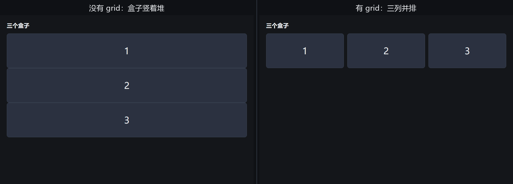

# 第 2a 课：先看懂 grid——三个盒子

> 这一课只有一个目标：让三个盒子从“竖着堆”变成“横着排”。
> 不碰项目文件，不碰 flex，不碰 min-height。

## 1. 布局就是摆盒子

网页上每个方块都是一个“盒子”。  
默认情况下，盒子从上往下堆，一个占一行。  
想让它们左右并排，就要告诉**大盒子**：

> “你变成一个格子架，横着切三列。”

CSS 里，这个“格子架”就叫 **grid**（格子）。

## 2. 做个 20 行的小实验

在 `handmade-tikz` 里新建 `grid-lab.html`，输入：

~~~html
<!doctype html>
<html lang="zh-CN">
<head>
  <meta charset="UTF-8">
  <title>Grid 实验：三个盒子</title>
  
</head>
<body>
  <h1>三个盒子</h1>

  

    
1

    
2

    
3

  

</body>
</html>
~~~

打开它，你会看到三个盒子竖着堆，每个占满一行。这是 `
` 的默认行为。

## 3. 只加三行

找到 `#shelf { }`，把它改成：

~~~css
#shelf {
  display: grid;
  grid-template-columns: 1fr 1fr 1fr;
  gap: 12px;
}
~~~

刷新。三个盒子应该变成一行三列。

## 4. 这三行是什么意思

- `display: grid;`  
  把这个大盒子变成“格子架”。它的直接子元素会自动变成格子里的东西。

- `grid-template-columns: 1fr 1fr 1fr;`  
  横着切三列，每列一份。  
  `fr` 读作“份”。`1fr` = 一份；三个 `1fr` = 三等分。

- `gap: 12px;`  
  格子之间的缝是 12px。

你不需要背英文。先记中文：

| 英文 | 中文意思 |
|---|---|
| `display: grid` | 变成格子架 |
| `grid-template-columns` | 横着切几列 |
| `1fr` | 一份 |
| `gap` | 格子之间的缝 |

## 5. 马上试三个变化

每次只改一个地方，刷新看结果：

1. 把 `1fr 1fr 1fr` 改成 `1fr 1fr`：  
   变成两列；第三个盒子会掉到第二行。

2. 把 `1fr 1fr` 改成 `2fr 1fr`：  
   第一列占两份，第二列占一份，所以第一列更宽。

3. 把 `gap: 12px;` 改成 `gap: 40px;`：  
   缝变大。

4. 在 HTML 里再加一个 `
4
`：  
   三列的话，第四个会掉到第二行。

5. 把 `display: grid;` 删掉：  
   又变回竖着堆。

## 6. 这一课只要记住

- 默认：盒子竖着堆。
- 大盒子加 `display: grid`：变成格子架。
- `grid-template-columns: 1fr 1fr 1fr`：横着切三列，每列一份。
- `gap`：格子之间的缝。
- 小盒子不需要知道 grid，它们只是被放进格子里的东西。

## 7. 下一课

等你看到三个盒子并排，我们再回到编辑器布局：  
把“1、2、3”换成“顶栏、源码、画布、状态栏”，把三个盒子变成你的 Mini TikZ Studio。
