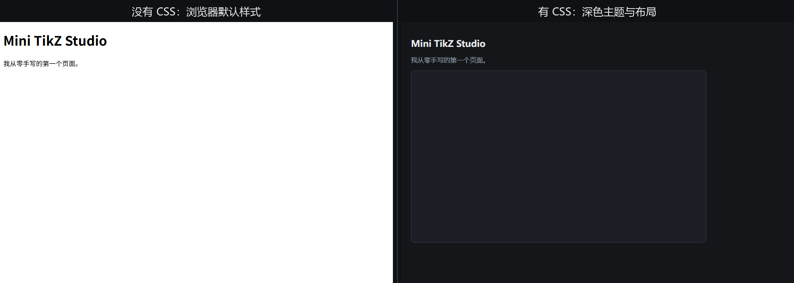
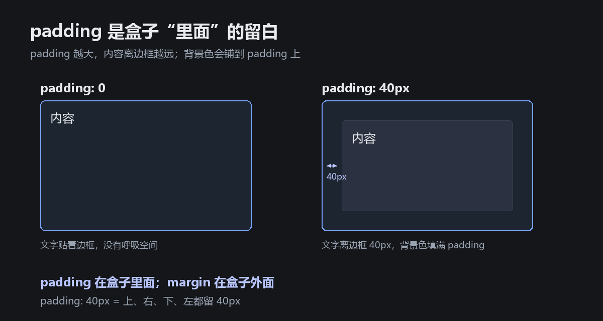

# CSS 速查：这段 `<style>` 到底在做什么

左边：只有 HTML，没有 CSS。浏览器用它自己的默认样式：白底、黑字、大标题，画布是透明的，所以看不见。

右边：加上你贴的这段 CSS。深色背景、标题变小、说明变灰、画布有了背景和边框。

## 1. 一句话

HTML 决定“有什么”，CSS 决定“长什么样”。

`<style>` 是 CSS 的容器，通常放在 `<head>` 里，作用于整个页面。它本身不会在页面上显示出来。

## 2. 读法：谁 { 改什么: 改成什么; }

~~~css
选择器 {
  属性: 值;
  属性: 值;
}
~~~

- **选择器**：要改谁。`body` 是整个页面，`h1` 是一级标题，`p` 是段落，`canvas` 是画布。
- **属性**：改什么。背景、文字颜色、字号、边距、边框……
- **值**：改成什么。颜色、像素、字体……
- **分号**：每条声明结束。最后一条也建议写。
- **大括号**：把一组声明包起来。
- **注释**：`/* 这里写给人看的话 */`，浏览器会忽略。

## 3. 逐条拆开

~~~css
body {
  margin: 0;              /* 去掉浏览器默认的外边距 */
  padding: 24px;          /* 页面内边距：内容离窗口 24px */
  background: #14161a;    /* 页面背景色：深色 */
  color: #e8eaed;         /* 默认文字颜色：近白 */
  font-family: system-ui, sans-serif; /* 字体 */
}

h1 {
  font-size: 22px;        /* 一级标题字号 */
}

p {
  color: #9aa4b2;         /* 段落文字：灰蓝色 */
}

canvas {
  display: block;         /* 画布独占一行 */
  margin-top: 16px;       /* 画布上方留 16px */
  background: #1b1e24;    /* 画布背景色 */
  border: 1px solid #333a45; /* 1px 实线边框 */
  border-radius: 8px;     /* 圆角 8px */
}
~~~

### body：整个页面

- `margin: 0;`：浏览器默认给 body 加了约 8px 的外边距，所以页面四周会有一圈白边。改成 0 就去掉了。
- `padding: 24px;`：body 内部留 24px 空白，内容不贴窗口边。
- `background: #14161a;`：页面背景。六位十六进制颜色，`#rrggbb`。
- `color: #e8eaed;`：默认文字颜色。`color` 管文字，`background` 管背景，别混。
- `font-family: system-ui, sans-serif;`：字体列表。先用系统界面字体（Windows 上通常是 Segoe UI），没有就用无衬线字体。

### h1：一级标题

- `font-size: 22px;`：把标题字号改成 22 像素。浏览器默认的 h1 更大（约 32px），所以左边的标题显得很大。
- 颜色没有单独写，会继承 body 的 `color`。

### p：段落

- `color: #9aa4b2;`：段落单独用灰蓝色，覆盖从 body 继承来的近白色。
- 这就是“继承 + 覆盖”：body 是全家默认，p 可以单独改。

### canvas：画布

- `display: block;`：canvas 默认是 inline（像一个大字符），会和文字排在一行，底部还常有几像素空隙。改成 block 后，它独占一行，宽高和 margin 也更听话。
- `margin-top: 16px;`：画布上方留 16px，和段落隔开。
- `background: #1b1e24;`：画布元素的背景色。注意：这只是 CSS 背景，不是画布里的图形；图形要等 JavaScript 画。
- `border: 1px solid #333a45;`：边框简写，等于：
  - `border-width: 1px;`
  - `border-style: solid;`
  - `border-color: #333a45;`
- `border-radius: 8px;`：四个角变成 8px 半径的圆角。

## 4. 三个必须理解的概念

### 4.1 继承

`body` 上的 `color` 和 `font-family` 会传给里面的 h1、p 等元素，这叫继承。

但 `background`、`border`、`margin`、`padding` 不会自动继承。所以画布需要自己写背景和边框。

### 4.2 盒子模型

每个元素都可以看成一个盒子：

~~~text
margin    元素外面的距离
border    边框
padding   元素里面的距离
content   真正的内容
~~~

**padding 是盒子“里面”的留白**：内容到边框之间的距离。`padding: 40px` 就是上、右、下、左都留 40px。

所以：

- body 的 `padding: 24px` 是“页面里面”留白；
- canvas 的 `margin-top: 16px` 是“画布外面”留白；
- canvas 的 `border` 画在背景外面；
- `border-radius` 把边框的角磨圆。

### 4.3 单位与颜色

- `px`：像素。`24px` 就是 24 像素。
- `0`：0 不需要单位，写 `0` 就行，不用写 `0px`。
- `#14161a`：颜色。六位十六进制，前两位红、中间两位绿、后两位蓝。
- `system-ui`、`sans-serif`：字体名称/类别，不是颜色也不是尺寸。

## 5. 哪些是语法，哪些只是设计

**语法（必须对）**：

- 选择器后面要有 `{`；
- 属性和值之间用英文冒号 `:`；
- 每条声明用英文分号 `;` 结束；
- 颜色用 `#` 开头；
- 大括号要成对。

**设计（可以随便改）**：

- 为什么是 `#14161a` 而不是别的深色？因为看起来舒服。
- 为什么是 `24px`、`22px`、`16px`、`8px`？因为大小合适。
- 为什么用 `system-ui`？因为不想引入外部字体。

这些数字和颜色不是 HTML/CSS 规定死的，是你（或写这段的人）选的。你完全可以改成别的。

## 6. 5 分钟实验

1. 把 `background: #14161a;` 改成 `#0b1020`，刷新，看背景变深。
2. 给 `h1` 加一行 `color: #7aa2ff;`，看标题变蓝。
3. 把 `border-radius: 8px;` 改成 `24px`，看圆角变大。
4. 删掉 `display: block;`，看画布下面是否出现小空隙；再放回去。
5. 把 `padding: 24px;` 改成 `0`，看内容是否贴边；再放回去。
6. 打开 F12 的 Elements，选中元素，在 Styles 面板里勾掉/改属性，实时看效果。刷新会恢复，因为改的是浏览器里的临时副本。

## 7. 常见错误

- 漏分号：`color: red` 后面直接写下一行，可能整条失效。
- 中文冒号/分号：`color：red；` 不行，必须是 `:` 和 `;`。
- 漏大括号：`body { ...` 没有 `}`。
- 拼错属性：`backgroud`、`font-sizee`。
- 颜色漏 `#`：`color: e8eaed;` 不行。
- 用 `=` 代替 `:`：`color = red;` 不行。
- 用 `//` 写注释：CSS 只认 `/* ... */`。
- 把 `color` 当成背景色：`color` 是文字颜色，背景用 `background`。

## 8. 和你现在的 index.html 的关系

你现在的 [index.html](../index.html) 里没有这段 CSS，也没有 h1 / p / canvas，所以打开是白底空白。这其实是个很好的实验：

- HTML 是内容；没有内容，CSS 没东西可装饰。
- CSS 是外观；没有 CSS，内容会用浏览器默认样式。

想恢复刚才的效果，把 `<style>` 放回 `<head>`，把 h1、p、canvas 放回 `<body>`。

## 9. 下一课

L02 会用 CSS Grid / Flex 把页面分成三栏。今天这些 `margin`、`padding`、`border`、`background`、`color`、`font-size` 就是那时候的积木。
