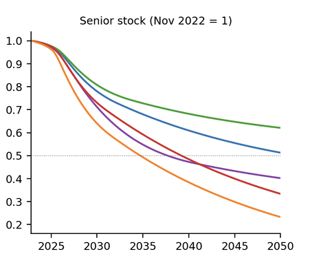
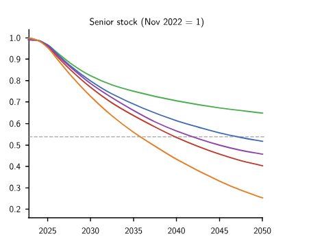
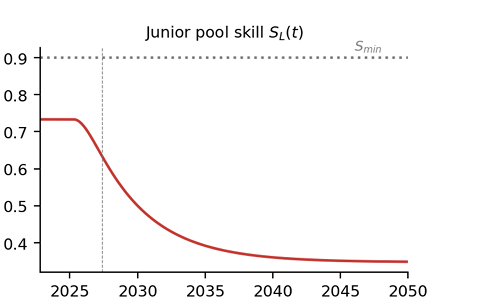
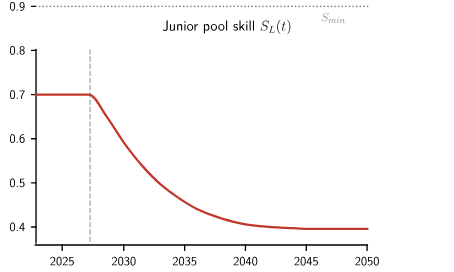
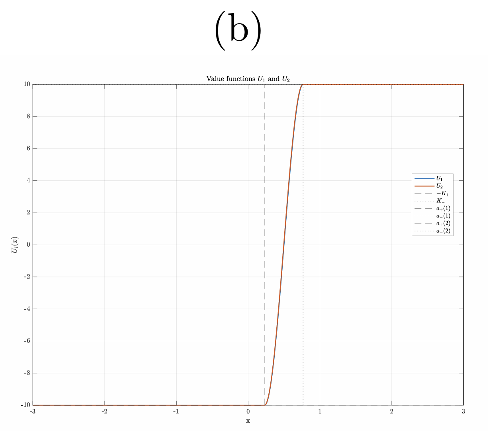
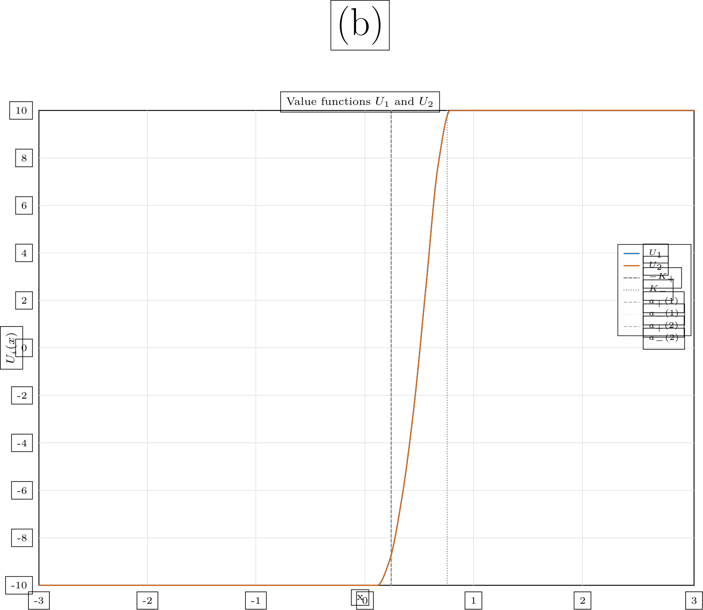
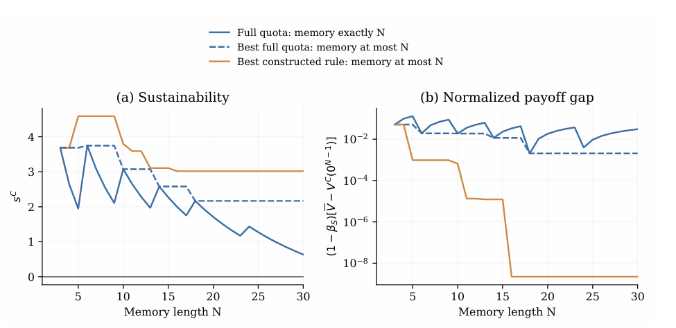
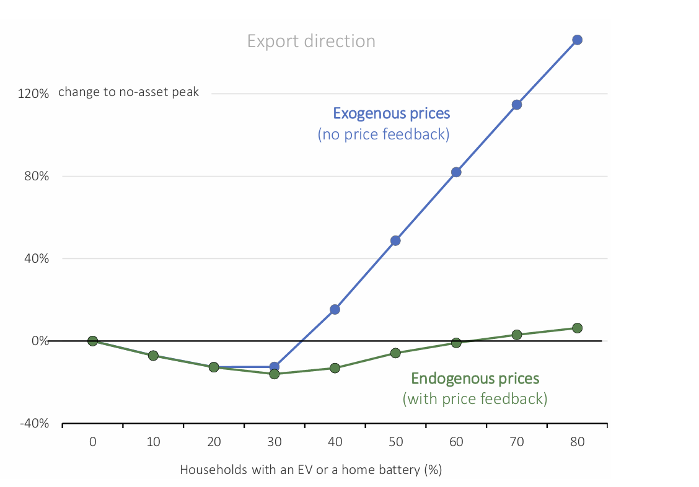

# 目前问题集合

1.   

会从图 $1.1$ 生成图 $1.2$。反映的问题是：曲线间的相对位置关系不正确；

**建议：** 将曲线之间的交点加入关键取点集合。也即：将取点公式改为：

$$
N_{req} = 2 + n + t + \displaystyle \sum_{j = 1}^{n + 1} \max \left( 0, \left\lceil \cfrac{S_j}{p} \sqrt{\min \left( 1, \cfrac{\Theta_j}{\theta_0}\right) } \right\rceil - 1\right) 
$$

其中 $t$ 表示的是这支曲线与其他支曲线交点个数。

2. 由图 

 

生成了图 

暴露的问题为：

- 坐标轴错位；
- 文字错位；

**建议：** 重新审查坐标轴位置、文字位置和函数曲线位置是否公用同一套坐标架构，如果不共用同一套坐标架构则转换为同一套坐标架构。转换时注意将各个文件中的坐标架构统一化。

另外，红色曲线的拐点位置和灰色参考线的位置也不统一。目前来看，灰色参考下先的位置正确，而红色曲线拐点位置略偏移。可能情况仍然是坐标架构不统一。

建议将统一的坐标架构设做虚拟坐标（即画布中某个固定位置，计算坐标是基于该位置的相对坐标），而不是利用原图中的坐标系。虚拟坐标可以起到统一坐标轴的作用。

3. 由

 

生成了

可以看到，文字周围不知为何都带上了边框。

**建议：** 目测问题是审核修正的时候使用了修改而不是覆盖，因此导致 $x_0$ 重影等问题，边框问题未知。另外，图例框过小，原因未知。

4. 由图
 

生成了

.png>)

暴露的问题：

- 只对曲线起点坐标做考察而不考察终点坐标
- $\text{(a) Sustainability}$ 中仍然暴露曲线相对位置关系的问题。说明对拐点的坐标记录不够清晰。
- $\text{(b)}$ 中纵坐标的文字出现重影。

**建议：**

将所有关键取点按照

$$
[id_1, x_1, y_1], [id_2, x_2, y_2] \cdots
$$

的方式存储。这里的 $x, y$ 是相对虚拟坐标系而不是实际坐标系。

其次，检查审核后是否完全重写覆盖（而不应该是在原基础上修改）以解决文字重影的问题。

5. 由图

生成了图

.png>)

暴露的问题是：对于蓝 / 绿点重合部分没有清晰判断；进而反应其对不同曲线重合的图像普遍存在问题。